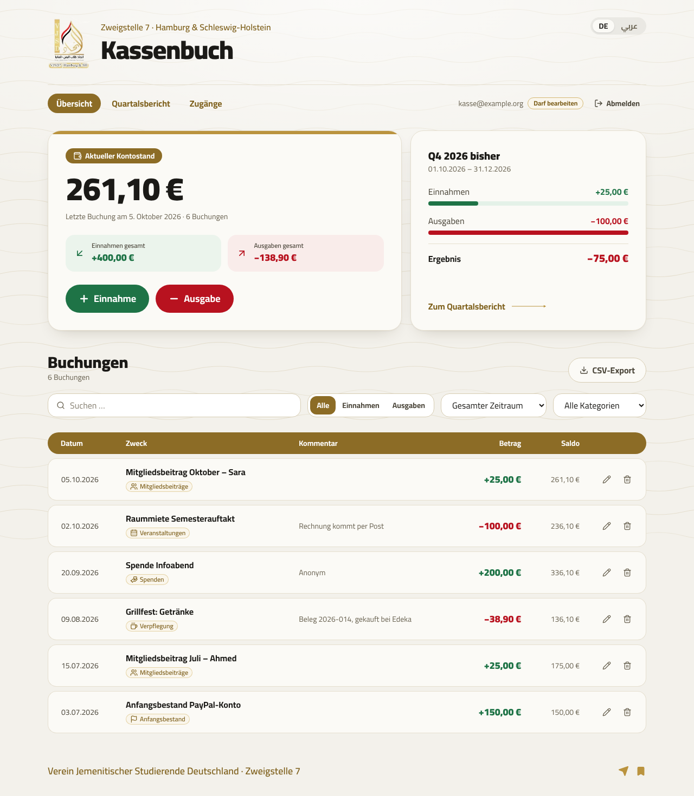
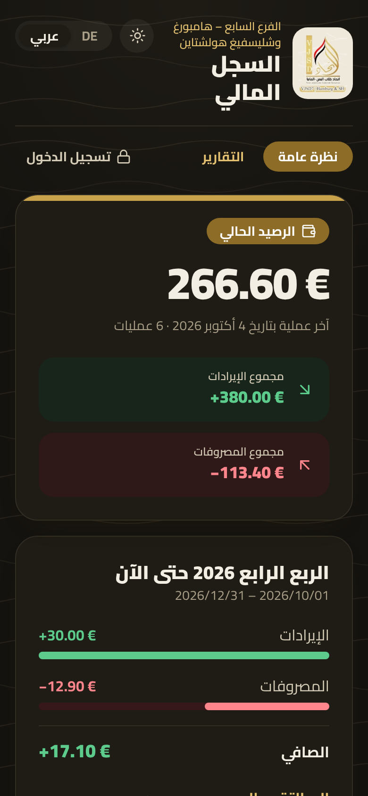

# VJSD7 Kassenbuch · السجل المالي

Finance tracker for the **VJSD – Zweigstelle 7 Hamburg & Schleswig-Holstein**, in **German and Arabic**.
Every euro that comes into or leaves the association's account is recorded here. The current balance on top
updates with each entry: income in green with a +, expenses in red with a −. Anyone with the link can look at
the balance, the entries and the reports; only the finance officer signs in to change anything.



<p align="center"></p>

## What it does

- **Current balance** at the top, plus totals of all income and expenses, and the running quarter at a glance.
- **Two buttons, Einnahme / Ausgabe**: pick one, type the amount (`12,50` or `12.50`, Arabic digits work too),
  date, purpose, category and an optional comment. The form shows how it will be booked (`+12,50 €` green or
  `−12,50 €` red).
- **Table of all entries** with date, purpose, category, comment, amount and the balance after each entry.
  Every entry can be **edited or deleted** (pencil and bin icons).
- **Search and filters** (income/expenses, quarter or year, category) and a **CSV export** for Excel.
- **Reports** (Berichte / التقارير) for a **month**, a **quarter**, a **year** or **any period you choose** (from one
  date to another): opening balance, income and expenses by category, a month-by-month overview, closing balance
  and all entries of the period, ready to **print or save as PDF** with a signature line. Each report has its own
  link (for example `…/de/report?period=2026-10` for October 2026) that you can send to the team.
- **Open for the team, locked for changes**: everyone with the link can look without an account. Only admins
  (you) sign in, and only they can add, change or delete entries.
- **Light and dark mode**, following the phone or computer setting, with a switch at the top.
- **History**: every change and every deletion is kept in the database, so nothing gets lost.
- **German and Arabic** (right-to-left), works on phones, made in the colours of the VJSD logo.

## Set it up (about 15 minutes, all free)

You need two free accounts: **Supabase** (database and login) and **Vercel** (the website).

### 1. Supabase: database and login

1. Sign up at [supabase.com](https://supabase.com) and create a **New project**. Name it e.g. `vjsd7-kassenbuch`,
   choose the region **Frankfurt (eu-central-1)** so the data stays in Germany, set a database password and keep
   it somewhere safe. Leave "Data API" switched on.
2. Open **SQL Editor → New query**, paste the whole file [`supabase/schema.sql`](supabase/schema.sql), and at the
   very bottom replace `your.email@example.com` with **the e-mail address you will sign in with**. Click **Run**.
   It should end with "Success". (Running it again later is safe; it keeps all data.)
3. Open **Authentication → Users → Add user → Create new user**, enter the same e-mail and a password, tick
   **Auto Confirm User**, and create it.
4. In **Authentication**, find **Allow new users to sign up** (under _Sign In / Providers_) and **turn it off**, then
   save. Now only people you create can sign in.
5. Click **Connect** at the top of the project (or open **Project Settings → API Keys**) and copy two values:
   - the **Project URL** (looks like `https://abcdefgh.supabase.co`)
   - the **Publishable key** (starts with `sb_publishable_`; older projects show the "anon public" key, which
     works too)

### 2. Vercel: the website

1. Go to [vercel.com/new](https://vercel.com/new), sign in with GitHub and import **alhakimi-16/Finance-Tracker**.
2. Before clicking Deploy, open **Environment Variables** and add:

   | Name                                   | Value               |
   | -------------------------------------- | ------------------- |
   | `NEXT_PUBLIC_SUPABASE_URL`             | the Project URL     |
   | `NEXT_PUBLIC_SUPABASE_PUBLISHABLE_KEY` | the Publishable key |

3. Click **Deploy**, open the address Vercel gives you, and sign in.
4. Back in Supabase: **Authentication → URL Configuration → Site URL** = your Vercel address (used if you ever send
   a password-reset e-mail from Supabase).

If you add or change the variables later, redeploy (Vercel → Deployments → ⋯ → Redeploy): the values are built
into the site. Without them, the site shows a "not connected yet" page with these steps.

### 3. Share it with the team

Board members only need the link; they don't need an account. To let someone else **edit** too (for example the
next finance officer):

1. In the app, sign in, open **Konto**, and add their e-mail under **Wer darf bearbeiten?**
2. In Supabase, create their login: **Authentication → Users → Add user → Create new user** (tick Auto Confirm User).
3. Give them the password. They can change it in the app under **Konto → Mein Konto**.

To take the editing rights away, remove the e-mail in **Konto**; it takes effect immediately.

## Using it

- **Start balance:** if the PayPal account already had money when you started, book it once as an income with
  the category _Anfangsbestand_.
- **Sign in:** **Anmelden** at the top right. Visitors never need this.
- **New entry:** click **+ Einnahme** or **− Ausgabe** on the overview.
- **Fix a mistake:** pencil icon in the row; delete with the bin icon.
- **Monthly report for the team meeting:** **Berichte → Monat**, pick the month, then either **Link kopieren** and
  send the link to the group, or **Drucken oder als PDF speichern** (in the print window choose "Save as PDF").
  **Quartal**, **Jahr** and **Zeitraum** (any start and end date) work the same way.
- **Excel:** the **CSV-Export** button downloads the entries currently shown (filters apply). Amounts use decimal
  commas and semicolons, which German Excel opens directly. Expenses are negative numbers, so a sum in Excel
  gives the balance.

## Good to know

- **Free Supabase projects pause after about a week without use.** If the app says it cannot reach the database,
  open [supabase.com](https://supabase.com), select the project and click **Restore**. Your data is kept (Supabase
  allows restoring within 90 days). Opening the app now and then prevents it.
- **Backups:** the free plan has no downloadable backups. Export the CSV each quarter and keep it with the
  quarterly report.
- **Changed or deleted entries** can be looked up in Supabase → **Table Editor → transaction_history**.
- **Who sees what:** anyone with the link sees the balance, all entries (amount, date, purpose, category, comment)
  and the reports. So keep comments to what the whole team may read, and avoid members' full names or private
  details there. Who typed an entry in, the change history and the list of admins are visible to admins only.
- **Is the key safe to publish?** Yes. The publishable key is meant to be public. The protection is in the database
  rules (row level security in `schema.sql`): everyone may read, only admins can write.
  Never put the _secret_ key (`sb_secret_…`) into Vercel or this repository.
- The site asks search engines not to list it, and it cannot be embedded in other websites.

## Change things

| What                      | Where                                                                                                            |
| ------------------------- | ---------------------------------------------------------------------------------------------------------------- |
| All texts (DE and AR)     | [`src/i18n/dictionaries.ts`](src/i18n/dictionaries.ts), German and Arabic in the same file                       |
| Categories                | [`src/lib/categories.ts`](src/lib/categories.ts) (id and icon) plus a name under `categories` in the texts       |
| Colours                   | [`src/app/globals.css`](src/app/globals.css)                                                                     |
| Logo                      | `public/logo.png`, cut out of the poster; replace it with the original logo file (same name) for a sharper image |
| Database and access rules | [`supabase/schema.sql`](supabase/schema.sql)                                                                     |

## Run it on your computer

Requires **Node.js 20.9 or newer**.

```bash
git clone https://github.com/alhakimi-16/Finance-Tracker.git
cd Finance-Tracker
npm install
cp .env.example .env.local   # then fill in the two values from Supabase
npm run dev
```

Open <http://localhost:3000>. It opens `/de` or `/ar` depending on the browser language.

| Command           | What it does                        |
| ----------------- | ----------------------------------- |
| `npm run dev`     | development server with hot reload  |
| `npm run build`   | production build (what Vercel runs) |
| `npm run start`   | serve the production build          |
| `npm run check`   | lint + type check + build           |
| `npm run format`  | format all files with Prettier      |
| `npm run preview` | build the test version (see below)  |

### Test version

`npm run preview` builds `preview/dist/kassenbuch-test.html`: the whole app in a single file, with a pretend
database that lives only in the open browser tab. It starts at 0 €, forgets everything when the page is reloaded,
and you sign in with any e-mail address and any password (nothing is checked or stored). It needs no Supabase and no server, so it is
handy for trying out changes before they go live. Printing and saving as PDF only work on the real site.

## Tech

Next.js 16 (static pages) · React 19 · TypeScript · Tailwind CSS 4 · Supabase (Postgres, Auth, row level
security) via supabase-js in the browser · Lucide icons · Cairo font (Arabic and Latin), self-hosted via
`next/font`.

## Ideas for later

- **Membership fees:** a list of members with who has paid for which month or semester, creating the income
  entries automatically.
- **Event budgets:** plan a budget per event and compare it with what was actually spent.
- **Receipts:** attach a photo or PDF of the receipt to each entry, with automatic receipt numbers per year.
- **Balance check:** type in the PayPal balance once a month and see straight away if something is missing.
- **History in the app:** show who changed what (the database already records it).
